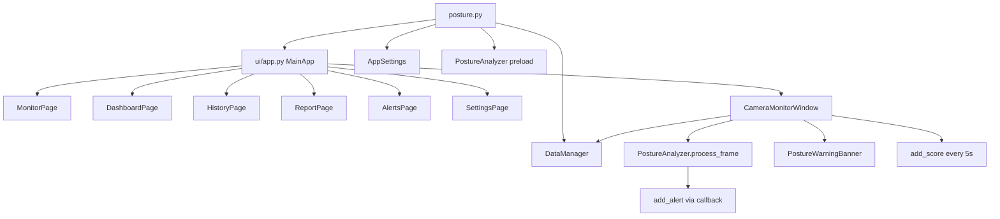

# 바른자세 — 코드 분석 (PHASE 0)

README는 무시하고 실제 소스만 기준으로 작성.

## 모듈별 책임

| 모듈 | 책임 |
|---|---|
| `config.py` | 경로(`~/.posture_app`), 저장 주기(5초), 세션 갭(120초), 보정 상수(`NECK_*`, `FWDIST_*`), 등급 색/라벨, 기간 포맷 |
| `analyzer.py` | MediaPipe Pose, 캘리브레이션 5초, 4축 판정, 4초 유지 규칙, 알림 콜백, 프레임 오버레이 |
| `data_manager.py` | `posture_data_v2.json` 저장/조회, 세션 분리, 알림 JPEG(320px) |
| `settings_manager.py` | `alert_interval` 영속화. **경로가 `C:\storage\med\app_settings.json`로 하드코딩** |
| `posture.py` | tkinter 엔트리, 분석기 프리로드, `MainApp` 기동 |
| `ui/app.py` | 사이드바 NAV 4개, 페이지 전환, 카메라 창 수명, 15초 대시보드 갱신 |
| `ui/camera_window.py` | 카메라 스레드, 점수 저장, 세션 통계, 배너 쿨다운, 재설정 |
| `ui/warning_banner.py` | 항상 위 오버레이, 메시지 3종, 3초 회복 카운트다운 |
| `ui/monitor.py` | 시작/중지 컨트롤. `_on_reset`/`_on_hide`는 죽은 코드 |
| `ui/dashboard.py` | 오늘의 현황 (사이드바 미연결) |
| `ui/history.py` | 달력 + 일 상세 + 알림 테이블(3행) |
| `ui/report.py` | 기간 집계. 시간대별/등급분포/인사이트는 주석 처리 |
| `ui/alerts.py` | 전체 알림 정렬(최근/나쁜순, 최대 100). 사이드바 미연결 |
| `ui/settings.py` | 알림 간격. 정보 카드에 잘못된 경로 하드코딩 |
| `ui/widgets.py` | ScoreRingCanvas, MetricCard, CalendarWidget |

## 호출 관계



## 데이터 흐름

카메라 프레임 → `cv2.flip(frame, 1)` → `PostureAnalyzer.process_frame` → `state` dict  
→ UI 10Hz 갱신 / 배너 / `SCORE_INTERVAL`(5초)마다 `add_score`  
→ 알림 콜백에서 현재 프레임 복사본 + snapshot으로 `add_alert`  
→ 창 숨김 시 카메라는 ~2fps, UI 틱은 계속 100ms.

## `state` dict 키

| 키 | 의미 |
|---|---|
| `detected` | 랜드마크 검출 |
| `calibrated` | 5초 기준 설정 완료 |
| `calib_remaining` | 남은 초 (5→0) |
| `score` | 종합 등급 **1=적정, 2=주의, 3=부적정** (낮을수록 좋음). 100점 체계 없음 |
| `grade` | 한국어 `"적정"|"주의"|"부적정"` |
| `label` | 영문 Good/Caution/Poor |
| `neck_flexion` | 목 굴곡 ° (보정 후) |
| `forward_dist` | 앞돌출 cm (표시용, ≥0) |
| `lateral_tilt` / `shoulder_tilt` | ° |
| `axis1`~`axis4` | 축별 등급 1~3 |
| `worst_axis` | `neck\|forward\|lateral\|shoulder` (적정일 때 None) |
| `neck_load_kg` | Hansraj 보간 kg |
| `nose_pos` / `shoulder_pos` | 오버레이용 픽셀 |

## JSON 스키마 (`~/.posture_app/posture_data_v2.json`)

```json
{
  "YYYY-MM-DD": {
    "sessions": [
      {
        "start": "HH:MM:SS",
        "duration": 0,
        "scores": [
          {
            "time": "HH:MM:SS",
            "score": 1,
            "grade": "적정",
            "neck_load_kg": 8.0,
            "worst_axis": "neck"
          }
        ]
      }
    ],
    "alerts": [
      {
        "time": "HH:MM",
        "message": "...",
        "severity": "warn|danger",
        "img_path": ".../alert_images/alert_*.jpg",
        "score": 3,
        "axis1": 3, "axis2": 1, "axis3": 1, "axis4": 1,
        "worst_axis": "neck",
        "neck_flexion": 22.1,
        "neck_load_kg": 15.2,
        "forward_dist": 3.0,
        "lateral_tilt": 2.1,
        "shoulder_tilt": 1.4
      }
    ]
  }
}
```

세션 분리: 같은 날 마지막 점수 시각과 현재 시각 차이가 `SESSION_GAP_SEC=120` 미만이면 기존 세션에 append, 아니면 새 세션.

## tkinter 전용 vs 이식

**재설계 (React):** 창/모달/숨기기, Canvas 차트, CalendarWidget, ScoreRingCanvas, 사이드바, 항상-위 배너.

**그대로 호출:** `PostureAnalyzer` 판정/임계/보정/4초 유지/캘리브레이션, `DataManager` 포맷, `AppSettings.alert_interval`, report 집계 로직.

## 이슈 검증

1. **SETTINGS_FILE 하드코딩** — 맞음. `C:\storage\med\app_settings.json`. 다른 PC에서 깨짐. `config.DATA_DIR` 아래로 이동.
2. **정보 카드 잘못된 경로** — 맞음. `ui/settings.py`에 `C:\storage\med\posture_data.json` (실제는 `~/.posture_app/posture_data_v2.json`).
3. **stretch_goal / sensitivity** — `app_settings.json`에 있으나 코드에서 읽지 않음. UI 만들지 않음. 저장 시 키 보존.
4. **dashboard / alerts NAV 없음** — 맞음. 페이지는 생성되지만 `NAV_ITEMS`에 없음. 새 UI에서 측정 하단(대시보드) + 기록(알림)로 살림.
5. **monitor `_on_reset` / `_on_hide`** — 맞음. 존재하지 않는 `_set_state` 호출. 이식 안 함.
6. **report 주석 위젯** — 시간대별 패턴, 등급 분포, 인사이트. **이식 제외**.

추가 관찰:
- `analyzer.py`는 plyer를 import만 하고 호출하지 않음. 알림은 콜백 → `add_alert`만. 새 백엔드에서 plyer.notify를 콜백에 추가.
- 캘리브레이션 완료 2초 후 `withdraw` — 새 UI에서는 제거.
- history 알림은 페이지당 3행. 요구사항은 5행으로 변경.
- AlertsPage 상세 팝업은 사진+메시지뿐. `_AXES` 상수는 정의만 되고 카드에 미사용. 요구사항에 따라 상세 모달에 축 수치를 표시.

## 아키텍처 (확정)

FastAPI + MonitorService(카메라 백그라운드) + Vite/React. 분석은 Python 유지. 측정은 페이지가 아니라 싱글턴 서비스.

## 단계 계획

1. PHASE 1 — settings 경로 수정, backend REST/WS/MJPEG, report_service
2. PHASE 2 — Vite 골격, 토큰, 레이아웃, WS 스토어, 전역 배너
3. PHASE 3 — 자세 측정 + 오늘의 현황
4. PHASE 4 — 분석 / 기록 / 설정
5. PHASE 5 — 빈 상태·빌드·RUNNING.md

## 결정 사항

- 설정 파일: `~/.posture_app/app_settings.json`. 새 파일이 없고 구 경로(`C:\storage\med\app_settings.json`)가 있으면 1회 복사(키 보존).
- 알 수 없는 설정 키는 `_data.update` 후 통째로 저장해 보존.
- 알림 id: `{date}-{원본배열인덱스}` (저장 포맷 불변).
- 알림 테이블 페이지당 **5행** (요구사항). 정렬·전체(최대 100) 토글 포함.
- 리포트 주석 섹션(시간대별 패턴/등급 분포/인사이트) 제외.
- 캘리브레이션 후 화면 숨김 제거. 상태 문구만 전환.
- 세션 통계/점수저장/배너는 원본 `_refresh_ui`(100ms)와 같이 **10Hz 틱**에서 수행. 카메라만 visible에 따라 0.08/0.5초.
- plyer 알림은 분석기 알림 콜백에서만, try/except.
- 대시보드 시간대 차트 x축은 원본과 같이 **8~21시**.
- 날짜 헤더는 요구사항대로 **1초** 갱신. 오늘 현황 REST는 **15초**.
- 문제 카드 퍼센트는 서버가 계산한 `percent`를 표시 (원본 UI는 평균값을 숫자로 보여줬으나 화면 요구는 퍼센트).
- 로고는 기존 `baruna-assets` SVG를 메타데이터 없이 복사해 사용. v2 제안 없음.
- 개발 기본 포트: uvicorn 8000, Vite 5173 (`/api`, `/ws` 프록시).
- 측정 중 페이지 이동해도 MonitorService가 카메라를 유지.
- 프론트 등급 색은 디자인 토큰(Good `#26B483`, Warn `#FDAE35`, Danger `#FC8181`)을 쓰되, `score_grade` 분기(≤1 / ≤2 / else)는 `config.py`와 동일.
- Web Notification은 탭이 숨겨진 동안 `banner.show` 상승 엣지에서만. 권한은 측정 시작 시 1회 요청.
